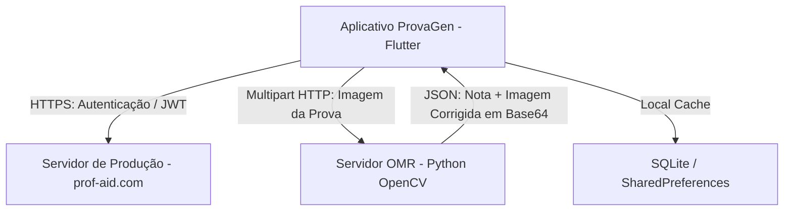

# Guia de Integração: ProvaGen Mobile ↔ prof-aid.com

Este documento descreve as especificações técnicas de integração, APIs e fluxos de comunicação entre o aplicativo móvel **ProvaGen** (Flutter), o servidor de processamento OMR (Python/OpenCV) e o painel web de produção **prof-aid.com**.

---

## 🗺️ Arquitetura de Comunicação

O fluxo de dados do aplicativo é híbrido:
1. **Autenticação e Assinatura:** O aplicativo se comunica diretamente via HTTPS com a API de produção em `prof-aid.com`.
2. **Correção Óptica (OMR):** A leitura de imagens pesadas é descarregada localmente (ou em rede privada) em um servidor Flask/FastAPI rodando OpenCV, evitando latência de upload de arquivos pesados para a nuvem.
3. **Sincronização Offline:** Se o servidor principal estiver inacessível, o aplicativo salva o estado no banco de dados local SQLite e opera em modo Simulador/Offline.



---

## 🔐 1. Endpoints de Autenticação (`prof-aid.com`)

Todos os endpoints utilizam o formato **JSON** e requerem cabeçalhos adequados.

### 1.1. Login do Usuário
Autentica o professor no sistema web e obtém o token de sessão JWT.

*   **URL:** `https://prof-aid.com/api/auth/login`
*   **Método:** `POST`
*   **Cabeçalhos:**
    ```http
    Content-Type: application/json
    ```
*   **Corpo da Requisição (JSON):**
    ```json
    {
      "email": "professor@exemplo.com",
      "password": "senha_secreta_aqui"
    }
    ```
*   **Resposta de Sucesso (`HTTP 200 OK`):**
    ```json
    {
      "token": "eyJhbGciOiJIUzI1NiIsInR5cCI6IkpXVCJ9...",
      "email": "professor@exemplo.com",
      "subscription": {
        "status": "Premium",
        "plan": "Premium Ativo (Válido até 31/12/2026)",
        "expires_at": "2026-12-31T23:59:59Z"
      }
    }
    ```
*   **Resposta de Erro (`HTTP 401 Unauthorized` ou `HTTP 400 Bad Request`):**
    ```json
    {
      "message": "Credenciais inválidas ou e-mail não cadastrado."
    }
    ```

---

## 💳 2. Endpoint de Validação de Assinatura

Verifica se a assinatura do professor ainda está válida no banco de dados de produção.

*   **URL:** `https://prof-aid.com/api/subscription/validate`
*   **Método:** `GET`
*   **Cabeçalhos:**
    ```http
    Content-Type: application/json
    Authorization: Bearer <token_jwt_aqui>
    ```
*   **Resposta de Sucesso (Assinatura Ativa - `HTTP 200 OK`):**
    ```json
    {
      "status": "active",
      "plan": "Premium Ativo (Renovação Automática)",
      "expires_at": "2026-12-31T23:59:59Z"
    }
    ```
*   **Resposta de Sucesso (Assinatura Expirada - `HTTP 200 OK`):**
    ```json
    {
      "status": "expired",
      "plan": "Assinatura Gratuita (Expirada)",
      "expires_at": "2026-05-01T00:00:00Z"
    }
    ```
*   **Resposta de Erro (Token Inválido/Expirado - `HTTP 401 Unauthorized`):**
    ```json
    {
      "message": "Sessão expirada. Faça login novamente."
    }
    ```

---

## 🖨️ 3. Integração com Servidor OMR (OpenCV Backend)

Este endpoint é consumido localmente ou na rede Wi-Fi configurada na aba de ajustes do aplicativo.

*   **URL:** `http://<ip_configurado>:<porta>/api/correct`
*   **Método:** `POST`
*   **Tipo do Corpo:** `multipart/form-data`
*   **Parâmetros Form-Data:**
    *   `image`: Arquivo Binário (Foto tirada da câmera no formato JPEG ou PNG).
    *   `quiz_id`: Texto (Ex: `q1`)
    *   `keys`: Texto contendo array JSON serializado com as chaves corretas:
        ```json
        [
          {
            "questionNumber": 1,
            "correctOption": "A",
            "points": 1.5,
            "isCancelled": false,
            "redistributePoints": false
          },
          {
            "questionNumber": 2,
            "correctOption": "B",
            "points": 1.0,
            "isCancelled": true,
            "redistributePoints": true
          }
        ]
        ```
    *   `settings`: Texto contendo o objeto JSON serializado de configurações ativas:
        ```json
        {
          "adjustContrast": true,
          "vibrateOnScan": true,
          "showCorrectWrongCount": true,
          "language": "pt",
          "backendUrl": "http://192.168.1.15:5000",
          "cameraFocusThreshold": 5.0
        }
        ```
*   **Resposta de Sucesso (`HTTP 200 OK`):**
    ```json
    {
      "student_id": "r10042",
      "grade": 9.5,
      "correct_count": 9,
      "wrong_count": 1,
      "answers": {
        "1": "A",
        "2": "N",
        "3": "C",
        "4": "E"
      },
      "overlay_image_base64": "/9j/4AAQSkZJRgABAQAAAQABAAD/2wBDA..."
    }
    ```

> [!TIP]
> A resposta `overlay_image_base64` é a imagem JPEG da prova com as marcações desenhadas pelo OpenCV (círculos verdes para acertos e vermelhos para erros). O aplicativo converte esses bytes base64 em imagem local e a salva no dispositivo para zoom em tela cheia do professor.

---

## 📈 4. Roadmap de Extensão: Sincronização de Notas

Se futuramente você desejar enviar os dados das provas corrigidas diretamente para o banco de dados do **prof-aid.com**, implemente o seguinte padrão de API no seu painel web Laravel/Node:

### 4.1. Sincronizar Provas Corrigidas (Upload de Lote)
Envia as notas coletadas offline para atualização no banco centralizado.

*   **URL:** `https://prof-aid.com/api/quizzes/{quiz_id}/sync-papers`
*   **Método:** `POST`
*   **Cabeçalhos:**
    ```http
    Content-Type: application/json
    Authorization: Bearer <token_jwt>
    ```
*   **Corpo da Requisição (JSON):**
    ```json
    {
      "papers": [
        {
          "id": "p_1717279200000",
          "student_identifier": "r10042",
          "grade": 9.5,
          "correct_count": 9,
          "wrong_count": 1,
          "scanned_at": "2026-06-01T20:40:00Z",
          "answers": {
            "1": "A",
            "2": "N",
            "3": "C",
            "4": "E"
          }
        }
      ]
    }
    ```
*   **Resposta de Sucesso (`HTTP 200 OK`):**
    ```json
    {
      "status": "success",
      "updated_records": 1,
      "synced_at": "2026-06-01T23:55:00Z"
    }
    ```

---

## 🛠️ Como Ajustar no Código do Aplicativo
Caso as rotas de produção de `prof-aid.com` mudem de domínio ou formato de path:
1. Abra o arquivo [api_service.dart](file:///home/calefi/Documentos/provagen_cell/lib/services/api_service.dart).
2. Localize as URIs de requisições HTTPS (linhas ~26 e ~67).
3. Atualize os caminhos conformes e realize um novo build do AppBundle/APK.
