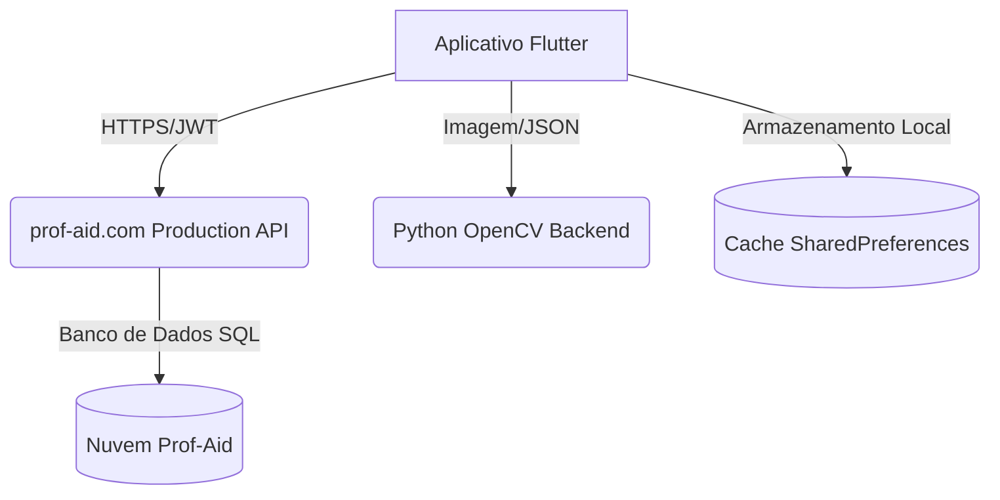

# ProvaGen Cell - Mobile Client

ProvaGen Cell é o aplicativo móvel oficial conectado à plataforma **prof-aid.com**, projetado para permitir que professores corrijam provas de múltipla escolha (gabaritos OMR) de forma instantânea usando a câmera do celular através de processamento de imagem com **OpenCV**.

O aplicativo foi desenhado no modelo **Offline-First**, permitindo que correções e edições sejam feitas sem internet dentro da sala de aula e sincronizadas com a nuvem do portal quando conveniente.

---

## 🚀 Funcionalidades Principais

*   **Correção de Gabaritos via Câmera (OMR)**: Digitalização de folhas de resposta em tempo real usando OpenCV no backend.
*   **Tratamento Avançado de Imagens**: Otimização contra iluminação desigual e impressões ruins utilizando CLAHE (equalização local) e fechamento/abertura morfológica.
*   **Leitura de QR Code e Código de Barras**: Detecção automática de identificadores de alunos impressos na folha (como RM/registro de estudante), associando a prova diretamente no banco.
*   **Registro Visual**: Armazenamento de fotos de baixa resolução das provas digitalizadas com marcações visuais das respostas (círculos verdes para acertos, vermelhos com "X" para erros). Permite zoom interativo.
*   **Recálculo Dinâmico de Notas**: Ajuste automático das notas de todos os alunos já corrigidos quando o gabarito oficial ou pesos das questões forem alterados.
*   **Suporte a Questões Anuladas**:
    *   *Redistribuição de pontos*: O peso da questão anulada é distribuído entre as questões ativas restantes.
    *   *Bonificação geral*: Todos os estudantes recebem os pontos da questão anulada automaticamente.
*   **Painel Estatístico & Pedagogia**:
    *   Distribuição de marcações por alternativa (Gráficos horizontais para A, B, C, D, E).
    *   Indicação das questões com maior índice de erros e acertos.
    *   **Alerta de Distratores**: Alertas automáticos ao professor se uma alternativa incorreta teve mais marcações do que o gabarito correto.
*   **Suporte Multilíngue (pt, en, es)**: Tradução em tempo real dos menus, cabeçalhos, formulários e botões para **Português, Inglês e Espanhol**.

---

## 🛠️ Arquitetura do Sistema

O aplicativo utiliza uma arquitetura cliente-servidor leve:


### 1. Aplicativo Móvel (Flutter)
Gerencia a interface gráfica reativa, controle de câmera nativo, armazenamento local de provas em formato JSON encapsulado no `shared_preferences` (com criptografia local padrão se desejado) e a exibição de overlays visuais.

### 2. Backend OpenCV (Python FastAPI)
Serviço autônomo responsável pela computação pesada de visão computacional:
*   Alinhamento de perspectiva da folha com base nos marcadores de canto.
*   Binarização e contagem de intensidade de pixels nas zonas das bolhas.
*   Leitura de QR Code/Código de Barras.
*   Envio do resultado JSON e da imagem final contendo os overlays coloridos em formato base64.

---

## 🔍 Pipeline de Processamento OpenCV (Correção de Impressão Ruim)

Para garantir alta taxa de acertos mesmo em condições ruins de toner ou papel amassado, aplicamos o seguinte pipeline no processamento:

1.  **Conversão de Cores**: Conversão de BGR para Grayscale.
2.  **CLAHE (Contrast Limited Adaptive Histogram Equalization)**: Equalização de contraste por blocos locais de pixels, removendo sombras e compensando impressões excessivamente claras sem gerar ruído.
3.  **Binarização Adaptativa**: Aplicação de `cv2.adaptiveThreshold` para isolar contornos das bolhas baseando-se na vizinhança local de luz.
4.  **Operações Morfológicas**:
    *   *Closing* (dilatação seguida de erosão): Preenche pequenos espaços e falhas de canetas fracas.
    *   *Opening* (erosão seguida de dilatação): Elimina pequenos grãos de sujeira ou poeira causados por rolo de impressão danificado.

---

## 📦 Versionamento & Fluxo de Publicação (Google Play Store)

Para colocar o aplicativo no canal de **Testes Internos (Internal Testing)**:

1.  **Atualização de Versão**:
    Edite o arquivo [pubspec.yaml](file:///home/calefi/Documentos/provagen_cell/pubspec.yaml):
    ```yaml
    version: 1.0.0+1
    ```
    *   O número antes do `+` (`1.0.0`) é a versão de exibição pública (`versionName`).
    *   O número após o `+` (`1`) é o código sequencial de compilação (`versionCode`). **Sempre incremente este número ao subir uma nova build para a Play Store.**

2.  **Gerar Bundle de Lançamento**:
    Compile o pacote no formato Android App Bundle (`.aab`):
    ```bash
    flutter build appbundle
    ```
    O pacote gerado ficará no caminho:
    `build/app/outputs/bundle/release/app-release.aab`

3.  **Upload**:
    Acesse o [Google Play Console](https://play.google.com/console), navegue até seu app, selecione **Teste Interno**, crie uma versão e faça o upload do arquivo `.aab`. Adicione os e-mails dos testadores autorizados para liberar o download e as atualizações automáticas via loja oficial.

---

## 📂 Estrutura de Pastas do Aplicativo

*   `lib/models/app_models.dart`: Modelos de dados (Quiz, Student, Class, CorrectedPaper, AppSettings).
*   `lib/services/db_service.dart`: Cache offline do banco local usando `shared_preferences`.
*   `lib/services/api_service.dart`: Requisições HTTP para a API de produção do `prof-aid.com` e para o corretor OMR OpenCV.
*   `lib/services/app_state.dart`: Gerenciamento de estado global e reativo (Notifiers).
*   `lib/services/translation_service.dart`: Dicionário multilíngue dinâmico (pt, en, es).
*   `lib/theme/app_theme.dart`: Design system (Cores Slate-900, gradientes Indigo/Cyan, tipografia e estilos globais).
*   `lib/screens/`:
    *   `login_screen.dart`: Tela de autenticação integrada com a nuvem do prof-aid.
    *   `main_layout.dart`: Estrutura de navegação inferior com suporte a idiomas.
    *   `quizzes_tab.dart`: Listagem e criação de quizzes/provas.
    *   `classes_tab.dart`: Visualização de turmas organizadas por instituição.
    *   `students_tab.dart`: Listagem e detalhes de notas atribuídas aos estudantes.
    *   `account_tab.dart`: Perfis, validação de assinaturas e tela de configurações do corretor.
    *   `quiz_detail_screen.dart`: Painel principal do quiz com botões de ação e resumo pedagógico.
    *   `edit_key_screen.dart`: Editor de gabarito oficial com regras de cancelamento e pontos dinâmicos.
    *   `scan_paper_screen.dart`: Scanner de câmera nativo com suporte a QR code e visualizações simuladas em tempo real.
    *   `review_papers_screen.dart`: Revisão de provas corrigidas com suporte a zoom da folha digitalizada.
    *   `item_analysis_screen.dart`: Painel estatístico detalhado das questões e alertas de distratores.
